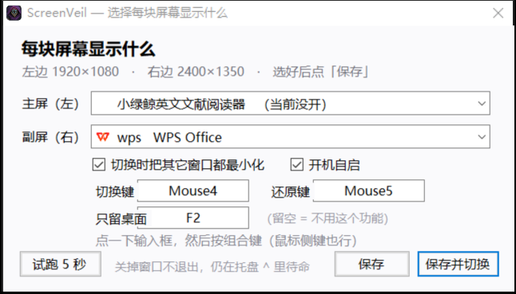

# ScreenVeil

One hotkey drops a "work layout" over your monitors: the apps you picked fill each screen,
everything else gets minimized. Another key puts every window back exactly where it was.

双屏/单屏一键切换工作布局：选好的应用铺满每块屏幕，其它窗口全部最小化；再按一下，所有东西精确回到原位。



## Features

- **Pick by name, not by config file** — a small window lists your currently open apps with icons; choose one per monitor.
- **`Ctrl+Alt+M` to switch, `Ctrl+Alt+R` to restore** — both rebindable: click the box and press the combo you want.
  Single `F1`–`F12`, `Pause`, `PrintScreen` work without modifiers, and **mouse side buttons** (`Mouse4` / `Mouse5`) can be bound too.
- **Idempotent** — pressing "switch" again just re-applies the layout. It never eats your original window positions, so "restore" keeps working.
- **Restore keeps windows on their own screen** — if a window was saved half-overlapping the next monitor, it gets pulled back inside its own monitor (`restoreClamp`).
- **Single monitor? Fine.** Screens that don't exist are skipped, and the picker hides the second row.
- **Portable** — one `.exe`, no installer, no runtime to download (Windows 10/11 ship .NET Framework 4.x).
- **Quiet** — desktop notifications are off by default; errors still show a dialog.

## Usage

1. Double-click `ScreenVeil.exe`.
2. Pick an app for the left (primary) and right screen — the dropdown lists what's running right now.
3. Hit **Save**.
4. `Ctrl+Alt+M` — the chosen apps fill the screens, everything else minimizes.
   `Ctrl+Alt+R` — everything goes back.

The window can be closed: the app keeps living in the system tray (Windows 11 hides new tray icons under `^`).
Double-click the exe again to bring the window back — it won't start a second copy.

There are three buttons:

| Button | What it does |
|---|---|
| **Save** | Remember the choice |
| **Save & switch** | Remember it and switch immediately |
| **Dry run 5s** | Switch, wait 5 seconds, restore, and show a report of what landed where |

## Configuration

`screenveil.json` sits next to the exe and is re-read automatically when it changes.

```json
{
  "hotkey": "Ctrl+Alt+M",
  "restoreHotkey": "Ctrl+Alt+R",
  "toggleOnRepeat": false,
  "minimizeOthers": true,
  "neverMinimize": [],
  "targets": [
    { "monitor": 1, "process": "idea64", "exe": "C:\\...\\idea64.exe" },
    { "monitor": 2, "process": "msedge", "title": "docs" }
  ]
}
```

| Field | Meaning |
|---|---|
| `hotkey` / `restoreHotkey` | `Ctrl+Alt+M` style combos, or `Mouse4` / `Mouse5` for mouse side buttons |
| `monitor` | `1` = left/primary, `2` = right |
| `process` | Process name without `.exe` |
| `exe` | Optional: launch it if it isn't running |
| `args` | Optional launch arguments |
| `title` | Optional regex to pick a specific window |
| `span` | `true` = stretch this window across all monitors |
| `toggleOnRepeat` | `true` = the switch key toggles back instead of re-applying |
| `minimizeOthers` | Minimize everything that isn't a target |
| `neverMinimize` | Process names that should survive the switch |
| `hideInsteadOfMinimize` | Hide instead of minimize (invisible even in the taskbar) |
| `restoreClamp` | Pull a restored window back inside its own monitor if it was saved overlapping another screen |

## Build

Only needs the C# compiler that ships with .NET Framework:

```powershell
powershell -ExecutionPolicy Bypass -File build.ps1
```

`make_icon.py` regenerates `screenveil.ico` from a source image (needs Pillow).

## Notes & limitations

- WinUI/UWP apps (Windows 11 Notepad, Settings, Photos…) refuse external resizing and can't be moved.
  Classic Win32 apps — Word, WPS, Chrome/Edge, VS Code, IntelliJ, TeXstudio — work fine.
- If a target runs elevated, this app must run elevated too, otherwise Windows (UIPI) blocks it.
  The app will tell you instead of failing silently.
- Exclusive-fullscreen games can't be moved.
- Windows applies a file's integrity label to the process it starts. If the exe lives in a folder
  labelled *Low* (some sandboxes do that), the process can't touch other windows and every
  `SetWindowPos` returns "access denied". `build.ps1` re-labels the output *Medium* to avoid this.

## License

MIT — see [LICENSE](LICENSE).
